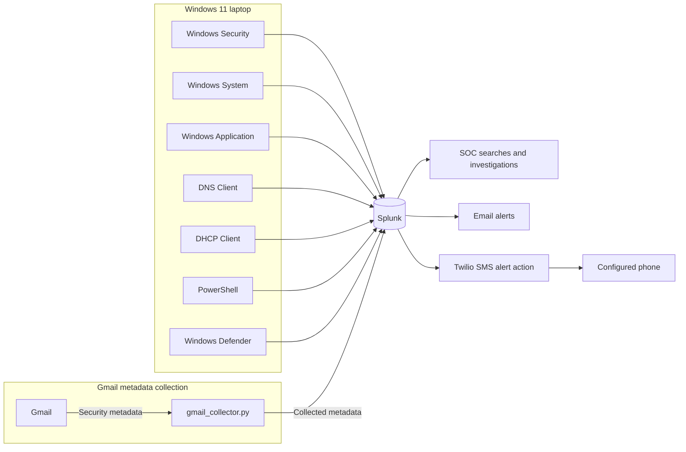

# My Windows 11 Laptop into a Mini SOC

A hands-on security monitoring lab built around a personal Windows 11 laptop and Splunk. This project documents the collection and investigation of endpoint and Gmail security metadata, with practical examples of the searches and workflows used to explore it.

> **Project status:** The telemetry statuses below reflect the current status reported for this project.

## Overview

This project documents my journey of turning a personal Windows 11 laptop into a small Security Operations Center (SOC) monitoring lab using Splunk.

The objective is to collect security telemetry from the endpoint, analyze events in Splunk, develop detections, and practice real-world SOC investigation workflows. The lab also includes Gmail security metadata to support phishing investigation practice.

## Project goals

- Collect Windows security telemetry.
- Monitor authentication, DNS, DHCP, PowerShell, and Windows Defender activity.
- Integrate Gmail security metadata.
- Investigate suspicious activity using Splunk.
- Build and refine SPL detection queries.
- Practice false-positive and false-negative analysis.
- Develop phishing investigation workflows.
- Create configurable browser and Windows security detections.
- Send alert notifications through email and SMS.

## Architecture

The diagram shows the documented collection and alerting paths. Splunk searches endpoint events and Gmail security metadata, then sends configured notifications through email or the Twilio SMS action.



## Current telemetry

| Source | Reported status |
| --- | --- |
| Windows Security | ✅ Enabled |
| Windows System | ✅ Enabled |
| Windows Application | ✅ Enabled |
| DNS Client | ✅ Enabled |
| DHCP Client | ✅ Enabled |
| PowerShell | ✅ Enabled |
| Windows Defender | ✅ Enabled |
| Gmail security metadata | ✅ Connected |
| Splunk | ✅ Running |

The alert searches are included but are disabled until notification recipients, Twilio credentials, and schedules are configured.

## Example investigations

These searches are starting points for exploring the events collected in this lab. Adjust the time range and fields to fit the investigation.

### Windows authentication

Find failed logon events (Event ID `4625`):

```spl
index=windows sourcetype="WinEventLog:Security" EventCode=4625
```

Find successful logon events (Event ID `4624`):

```spl
index=windows sourcetype="WinEventLog:Security" EventCode=4624
```

### DNS

Search DNS Client operational events:

```spl
index=windows sourcetype="WinEventLog:Microsoft-Windows-DNS-Client/Operational"
```

### Gmail metadata

Search collected Gmail metadata and display selected fields:

```spl
index=windows sourcetype="gmail:email"
| table _time from to subject date message_id
```

## Alerting

The Splunk alerting app in [splunk/mini_soc_alerts](splunk/mini_soc_alerts/README.md) includes:

- Browser launch rules for Chrome, Edge, and Firefox. Edit `splunk/mini_soc_alerts/lookups/browser_alert_rules.csv` to enable, disable, or tune each browser's process and suspicious-switch patterns.
- Windows Security detections for repeated failed logons, security audit log clearing, audit policy changes, user creation, and security-group membership changes.
- Microsoft Defender malware and potentially unwanted software detections.
- Email actions through Splunk and a custom Twilio SMS action.

The scheduled searches and notification actions are off by default. Follow the app guide to configure SMTP, Twilio system environment variables, browser rules, and alert schedules. Browser process detections rely on Windows Security process-creation auditing (Event ID 4688). Capturing command lines also requires the Windows policy **Include command line in process creation events**. Those command lines are recorded in plain text, so restrict access to the event log and Splunk data.

The SMS action sends a concise alert summary and does not include full process command lines or raw events.

## SOC investigation workflow

Use a repeatable process to validate alerts and document what the evidence shows:

1. **Alert** — Identify the event or behavior that needs review.
2. **Validate** — Check whether the alert is supported by the available telemetry.
3. **Collect evidence** — Gather relevant events and context from Splunk.
4. **Correlate events** — Compare activity across sources and time.
5. **Determine scope** — Establish which accounts, systems, or events are involved.
6. **Classify activity** — Decide whether the activity appears benign, suspicious, or malicious.
7. **Document findings** — Record evidence, decisions, and follow-up actions.

## Repository structure

```text
.
├── collector/
│   └── gmail_collector.py
├── queries/
│   ├── dns-investigation.spl
│   ├── gmail-investigation.spl
│   └── windows-authentication.spl
├── splunk/
│   ├── inputs.conf.example
│   └── mini_soc_alerts/
│       ├── bin/
│       │   └── twilio_sms.py
│       ├── default/
│       │   ├── alert_actions.conf
│       │   ├── app.conf
│       │   ├── savedsearches.conf
│       │   └── transforms.conf
│       ├── lookups/
│       │   └── browser_alert_rules.csv
│       └── README.md
├── .gitignore
└── README.md
```

## Security and privacy

This repository does not contain:

- Gmail passwords or app passwords.
- API keys, authentication tokens, or private credentials.
- Personal email contents.
- Sensitive configuration files.

Real Gmail data is kept locally and excluded from version control using `.gitignore`. Twilio credentials are supplied through Windows system environment variables and must never be committed. Local Splunk app overrides are ignored by Git. Review files and screenshots for credentials and personal information before committing changes.

## Roadmap

- Extract URLs from email metadata.
- Add SPF, DKIM, and DMARC analysis.
- Analyze attachments.
- Develop phishing detections.
- Integrate Sysmon.
- Add process monitoring.
- Expand Splunk dashboards, alert coverage, and response workflows.
- Map detections to MITRE ATT&CK.
- Expand detection engineering.
- Document incident-response case studies.

## Learning objective

This is a hands-on cybersecurity learning project focused on developing practical SOC analyst skills through endpoint monitoring, log analysis, detection engineering, and security investigation.

## Disclaimer

This is a personal defensive security lab intended for learning, experimentation, and cybersecurity portfolio development.