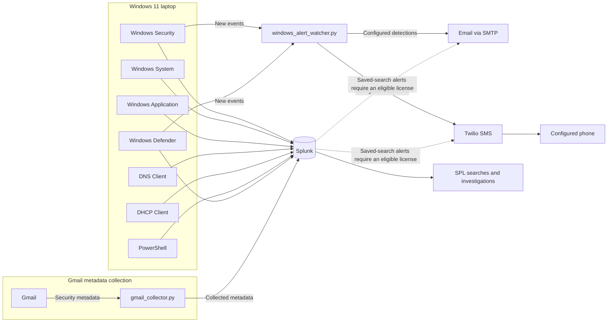

# My Windows 11 Laptop into a Mini SOC

A hands-on security monitoring lab built around a personal Windows 11 laptop and Splunk. This project documents the collection and investigation of endpoint and Gmail security metadata, with practical examples of the searches and workflows used to explore it.

> **Project status:** The telemetry statuses below reflect the current status reported for this project.

## Overview

This project documents my journey of turning a personal Windows 11 laptop into a small Security Operations Center (SOC) monitoring lab using Splunk.

The objective is to collect security telemetry from the endpoint, analyze events, develop detections, and practice SOC investigation workflows. The lab also includes Gmail security metadata to support phishing investigation practice.

## Project goals

- Collect Windows security telemetry.
- Monitor authentication, DNS, DHCP, PowerShell, and Windows Defender activity.
- Integrate Gmail security metadata.
- Investigate suspicious activity and develop SPL detection queries.
- Practice false-positive and false-negative analysis.
- Develop phishing investigation workflows.
- Detect suspicious browser launches and Windows security events.
- Send concise alert notifications through email and Twilio SMS.

## Architecture

Windows events flow to Splunk for search and investigation. A separate local watcher can read Windows Security and Defender events and send notifications directly, so notification delivery does not depend on Splunk scheduled-alert licensing.



## Current telemetry

| Source | Reported status |
| --- | --- |
| Windows Security | ✅ Enabled |
| Windows System | ✅ Enabled |
| Windows Application | ✅ Enabled |
| DNS Client | ✅ Enabled |
| DHCP Client | ✅ Enabled |
| PowerShell | ✅ Enabled |
| Windows Defender | ✅ Enabled |
| Gmail security metadata | ✅ Connected |
| Splunk | ✅ Running |

The local watcher and notification providers still need to be configured on the host before they send alerts.

## Example investigations

These searches are starting points for exploring events in Splunk. Adjust the time range and fields to fit the investigation.

### Windows authentication

Find failed logon events (Event ID `4625`):

```spl
index=windows sourcetype="WinEventLog:Security" EventCode=4625
```

Find successful logon events (Event ID `4624`):

```spl
index=windows sourcetype="WinEventLog:Security" EventCode=4624
```

### DNS

Search DNS Client operational events:

```spl
index=windows sourcetype="WinEventLog:Microsoft-Windows-DNS-Client/Operational"
```

### Gmail metadata

Search collected Gmail metadata and display selected fields:

```spl
index=windows sourcetype="gmail:email"
| table _time from to subject date message_id
```

## Alerting

The project provides two alerting paths:

- **Local Windows watcher:** [collector/windows_alert_watcher.py](collector/windows_alert_watcher.py) polls Windows Security and Defender event logs every five seconds and checks configurable detections. It can send a short email through SMTP and/or SMS through Twilio. It runs independently of Splunk's alerting feature and can be used alongside Splunk Free.
- **Splunk saved-search app:** [splunk/mini_soc_alerts](splunk/mini_soc_alerts/README.md) provides scheduled email and Twilio alert actions for Splunk installations with an eligible license.

The local watcher detects suspicious Chrome, Edge, and Firefox launch switches using [browser_alert_rules.csv](splunk/mini_soc_alerts/lookups/browser_alert_rules.csv); five or more failed logons for the same account and source within five minutes; Windows Security events 1102, 4719, 4720, 4728, and 4732; and Defender event 1116. Provider sending is off by default. Follow the [watcher guide](collector/README.md) before enabling email or SMS.

Browser process detections depend on Windows process-creation auditing (Event ID 4688). Capturing the command line also requires the Windows policy **Include command line in process creation events**. Windows records command lines as plain text, so restrict access to those logs. Notifications deliberately omit complete command lines and raw event content.

## SOC investigation workflow

1. **Alert** — Identify the event or behavior that needs review.
2. **Validate** — Check whether the alert is supported by the available telemetry.
3. **Collect evidence** — Gather relevant events and context from Windows Event Viewer or Splunk.
4. **Correlate events** — Compare activity across sources and time.
5. **Determine scope** — Establish which accounts, systems, or events are involved.
6. **Classify activity** — Decide whether the activity appears benign, suspicious, or malicious.
7. **Document findings** — Record evidence, decisions, and follow-up actions.

## Repository structure

```text
.
├── collector/
│   ├── README.md
│   ├── gmail_collector.py
│   ├── windows_alert_config.example.json
│   └── windows_alert_watcher.py
├── queries/
│   ├── dns-investigation.spl
│   ├── gmail-investigation.spl
│   └── windows-authentication.spl
├── splunk/
│   ├── inputs.conf.example
│   └── mini_soc_alerts/
│       ├── bin/
│       │   └── twilio_sms.py
│       ├── default/
│       │   ├── alert_actions.conf
│       │   ├── app.conf
│       │   ├── savedsearches.conf
│       │   └── transforms.conf
│       ├── lookups/
│       │   └── browser_alert_rules.csv
│       └── README.md
├── .gitignore
└── README.md
```

## Security and privacy

- Do not commit API keys, passwords, tokens, local watcher settings, or watcher state.
- The watcher reads event logs and sends concise summaries only. It does not include full command lines or raw event payloads in notifications.
- Twilio credentials and SMTP credentials are read from environment variables; keep them out of Git.
- Local Splunk app overrides are ignored by Git.
- Review files and screenshots for credentials and personal information before committing changes.

## Roadmap

- Extract URLs from email metadata.
- Add SPF, DKIM, and DMARC analysis.
- Analyze attachments.
- Develop phishing detections.
- Integrate Sysmon.
- Expand Splunk dashboards, alert coverage, and response workflows.
- Map detections to MITRE ATT&CK.
- Document incident-response case studies.

## Learning objective

This is a hands-on cybersecurity learning project focused on practical SOC skills through endpoint monitoring, log analysis, detection engineering, and security investigation.

## Disclaimer

This is a personal defensive security lab intended for learning, experimentation, and cybersecurity portfolio development.
